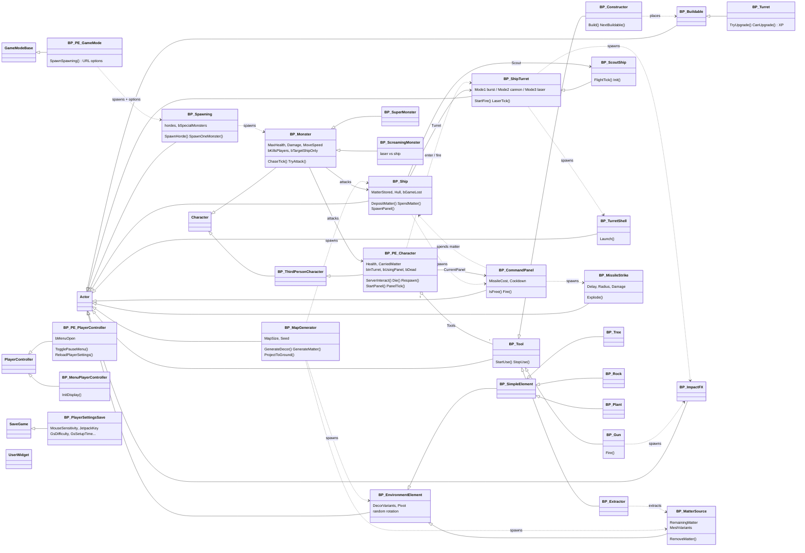
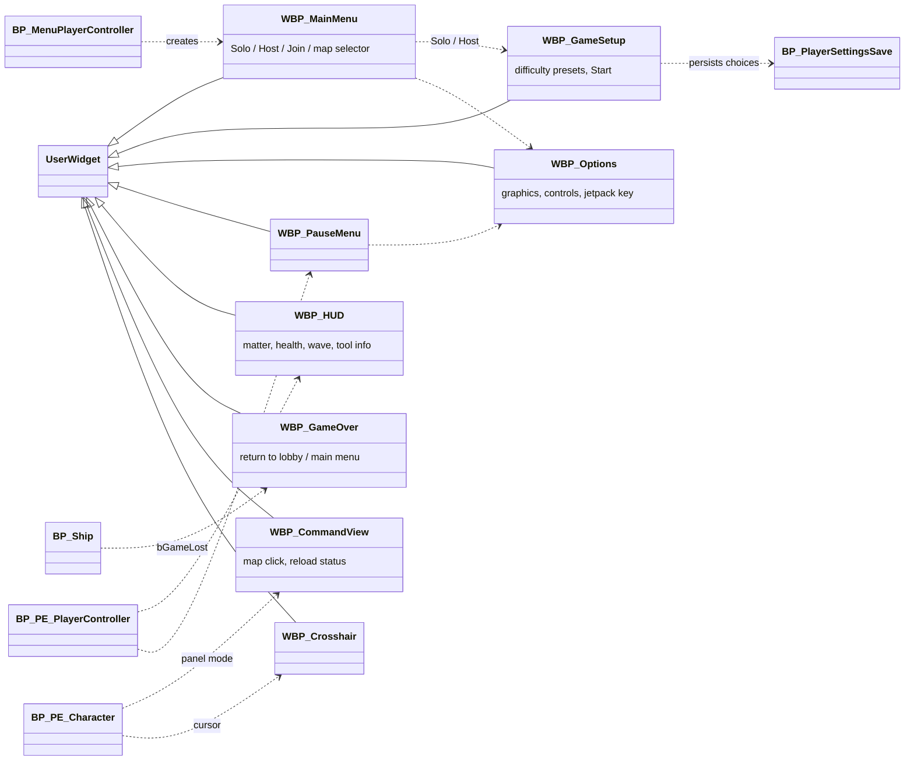
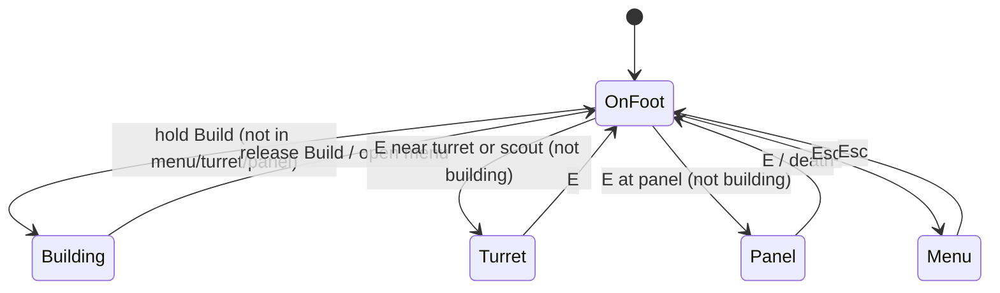

# PlanetEscape - class diagram (V0.1)

Blueprint-only project. Renders on GitHub and in any Mermaid viewer.
Inheritance = hollow arrow, association = plain arrow. Parents marked `?` were not re-verified.

## 1. Inheritance + core relations

## 2. UI

## 3. Control contexts (who can do what)

